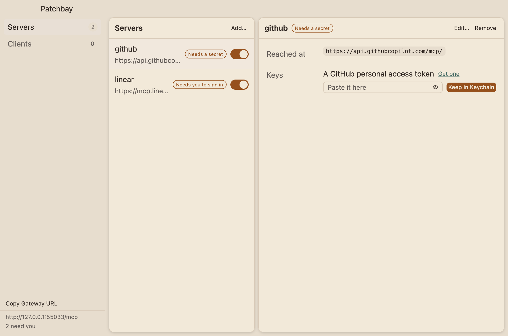
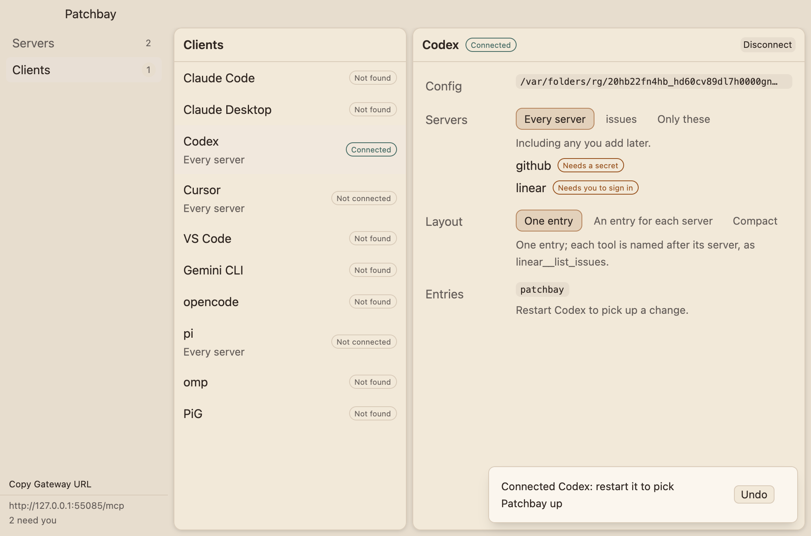

# Patchbay

One place for your MCP servers. Patchbay runs them, keeps their keys in the Keychain, signs in to the ones that use
OAuth, and puts every one behind a single local gateway. Then it points your AI tools at that gateway: Claude Code,
Claude Desktop, Codex, Cursor, VS Code, Gemini CLI, opencode, pi, omp and PiG.

Add a server once and every tool has it. Change a key once and every tool uses the new one. None of them ever sees
the key.



## What it does

- **Paste a server in.** Copy what a server's README gives you (a Claude Desktop block, a `claude mcp add` command, an
  `npx …` line or just a URL) and paste it into Add Server (⌘N). Patchbay shows what it read before adding anything.
  Keys in the paste go into the Keychain; your `patchbay.toml` only names them.
- **Keys and sign-ins, kept for you.** A server that needs a key asks for it once, in a masked field. A server that
  signs in with OAuth opens your browser once, and Patchbay keeps and refreshes the token. A wrong or expired key is
  replaced with Change Key.
- **One gateway, many tools.** Every tool talks to `http://127.0.0.1:7357/mcp`. Connect a tool in the Clients list and
  Patchbay writes its entry into that tool's own config, leaving everything else in it alone, with a backup beside it.
- **Choose what each tool gets.** Every server, a profile of them, or only the ones you tick. And how: one entry with
  every tool named after its server (`linear__list_issues`), an entry for each server, or compact: three tools that
  search for the rest and call them, so a tool with many servers keeps its context for the work.
- **Stays out of the way.** Close the window and the gateway keeps running from the menu bar, out of the Dock. Turn on
  Open at login in Settings and it's there whenever your tools are.



## Getting it

From [apps.phin.tech](https://apps.phin.tech), or with Homebrew, which also puts `patchbay` on your PATH:

```sh
brew install --cask phin-tech/tap/patchbay
```

Patchbay runs on macOS 14 Sonoma or later and updates itself.

## The command line

The app's own binary answers a command line too:

```sh
patchbay status                         # every server and what it needs
patchbay secret me/github-token         # keep a key (pasted on stdin) in the Keychain
patchbay sign-in linear                 # sign in to an OAuth server in the browser
patchbay clients                        # which tools are connected
patchbay connect cursor --servers linear --layout compact
patchbay bridge server/linear           # a server over stdio, for a tool that only runs commands
```

## More

- [Your servers: patchbay.toml](docs/servers.md)
- [Your tools: clients and layouts](docs/clients.md)
- [Building and releasing Patchbay](DEVELOPMENT.md)

Patchbay is made by Phin Tech, in Rust on [GPUI](https://gpui.rs), [gpui-kit](https://gpui-kit.com) and
[Typecase](https://git.phin.tech/sam/typecase). Apache-2.0.
