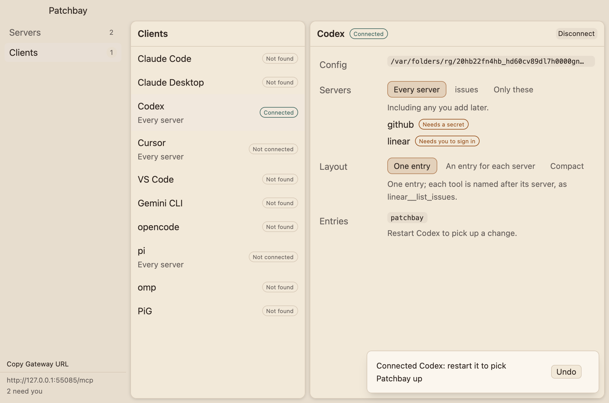

# Your tools: clients and layouts

Patchbay calls the AI tools it serves **clients**. Each one finds its MCP servers in a config file of its own; **Connect**
writes Patchbay's entries there, and only those, keeping a copy of the file as it was beside it
(`<file>.patchbay-backup`). **Disconnect** takes them out again. Restart a tool after connecting it, or after changing
what it gets.

| Client | Its config | How it reaches Patchbay |
| --- | --- | --- |
| Claude Code | `~/.claude.json` | over HTTP, added with Claude Code's own `claude mcp` |
| Codex | `~/.codex/config.toml` | over HTTP |
| Cursor and `cursor-agent` | `~/.cursor/mcp.json` | over HTTP |
| VS Code | `~/Library/Application Support/Code/User/mcp.json` | over HTTP |
| opencode | `~/.config/opencode/opencode.json` | over HTTP |
| pi | `~/.pi/agent/mcp.json` | over HTTP |
| omp | `~/.omp/agent/mcp.json` | over HTTP |
| PiG | `~/.pig/agent/mcp.json` | over HTTP |
| Claude Desktop | `~/Library/Application Support/Claude/claude_desktop_config.json` | `patchbay bridge` |
| Gemini CLI | `~/.gemini/settings.json` | `patchbay bridge` |

Over HTTP, the tool talks to the gateway at `http://127.0.0.1:7357` with its token, so Patchbay has to be running: keep
it in the menu bar, or turn on Open at login in Settings. A tool given `patchbay bridge` runs it as a command instead,
and the bridge opens Patchbay in the background if it isn't running.

## What each tool gets

**Servers.** Every server, a profile's, or **Only these**, ticked one by one. A server you add later reaches a tool on
Every server at once, and one on Only these when you tick it.

**Layout.**

- **One entry**, `patchbay`, with each tool named after its server: Linear's `list_issues` is `linear__list_issues`.
- **An entry for each server**, `patchbay-linear`, `patchbay-github`, so the tool lists each one and turns it on and off
  by itself. Patchbay keeps them in step as your servers change.
- **Compact**: one entry with three tools, `search_tools`, `describe_tool` and `call_tool`, that find and run every
  other one. A tool with many servers keeps its context for the work.

From a terminal: `patchbay connect <client> --servers linear,github --layout per-server`.

## The patch bay

The main window opens on the patch bay, a rack with a module for each tool on the left and each server on the right.
A **cable** runs from a tool's jack to a server's for each server the tool is given: drag one from a server to a tool
to give it that server, drag a plug to another tool to move it, or let it go over nothing to pull it out. Cables say
what a tool gets; its **Connected** switch says whether it has Patchbay at all, as **Connect** and **Disconnect** do,
and the buttons beside it choose its layout. Each of those is in the Clients menu too, for the tool chosen. Skills hang
below the servers and are patched to tools the same way; one of your own is hard-wired, and stays as it is until it's
taken over.

Turn it off in **Settings ▸ General** to open on Servers instead. **View ▸ Servers on the Patch Bay** and **Skills on
the Patch Bay** hide either part of it and show it again; hiding one only takes it off the rack, and every tool keeps
what it's given.

## Servers a tool already has

A tool that already has servers of its own shows them under **Its own**, and the first time you connect it, Patchbay
offers to take them over. **Take Over** (or **Take Over the Client's
Servers…** in the Servers menu) brings them into Patchbay: they open in Add Server as if pasted, so you see what
Patchbay will add and which keys it takes out for the Keychain. Choose **Add**, and Patchbay adds them to your
`patchbay.toml`, takes them out of the tool's config, and connects the tool if it wasn't, so it reaches them through
Patchbay from then on. Every other tool you connect gets them too. The tool's config as it was is kept beside it, as
`<file>.patchbay-take-over-backup`.

Only the servers you add leave the tool: one you delete from the paste before choosing **Add** stays where it is. So
does one Patchbay already has a server by the same name for, rather than replacing yours. Only a tool's user-level
servers are taken over this way; **Import** brings in a Claude Code project's too.

## Importing what your tools have

**Import from Your Clients…** in the Servers menu lists every server your tools keep of their own: for you, in each
Claude Code project (its local servers, and a project's `.mcp.json`), and your own skills. Nothing is ticked to begin
with: tick each one to bring in, and where a server is set up differently in two places, tick which one. Under each,
tick the tools to take it out of; a copy you leave unticked stays where it is. One Patchbay already has is shown, and
can't be brought in twice. A key in a server is shown only by its name.

**Import** opens the servers in Add Server, as Take Over does, so you see what's added and which keys go to the
Keychain. Choose **Add**, and they're taken out where you ticked, each file backed up first, as it was:
`<file>.patchbay-take-over-backup` beside it, and a project's `.mcp.json` in Patchbay's own folder, so nothing is left
in its repository. A tool a server leaves is connected to Patchbay, so it still has it.

## Skills

Tools that read agent skills get the ones you install in Patchbay too, each from its own skills folder: see
[Your skills](skills.md).

## A server that isn't ready

A server waiting for its key or a sign-in shows up in your tools as `<server>__needs_setup`. Calling it says what to do
in Patchbay, so an agent can tell you rather than fail quietly.
