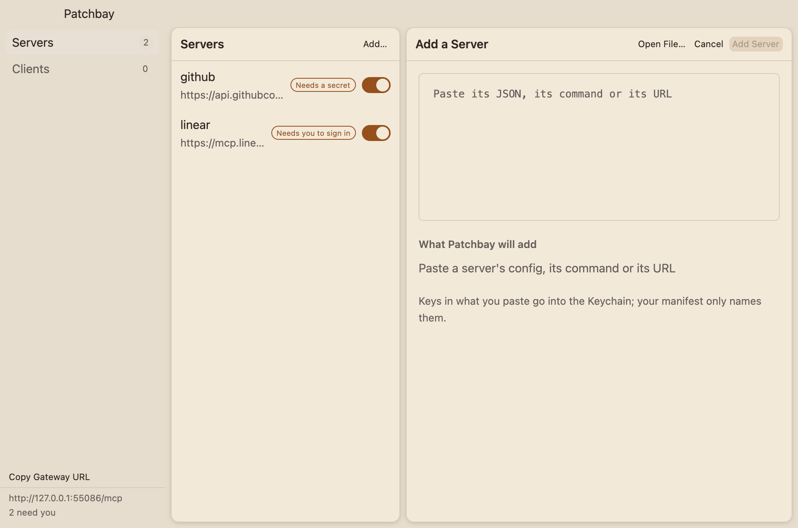

# Your servers: patchbay.toml

Patchbay's servers are in one file, `~/.config/patchbay/patchbay.toml`. Add Server
(⌘N) writes it for you, and **Edit patchbay.toml…** in the Servers menu opens it. After changing it by hand, choose
**Reload Servers** (⌘R).

The buttons beside the chosen server are in the Servers menu too, and so in the palette (⌘K): **Edit Server…**,
**Turn Server On** and **Off**, **Restart Server**, **Sign In to Server…**, **Sign Out of Server**, **Change Server's
Key…** and **Remove Server**.



## A server

A server either runs as a command on your Mac, or is reached at a URL.

```toml
# A command, which talks MCP on its stdin and stdout.
[servers.fetch]
command = "uvx"
args = ["mcp-server-fetch"]

# A remote server, with a key in a header.
[servers.github]
url = "https://api.githubcopilot.com/mcp/"
headers = { Authorization = "Bearer ${secret:github-token}" }

# A remote server you sign in to in the browser.
[servers.linear]
url = "https://mcp.linear.app/mcp"
auth = "oauth"
```

Patchbay runs a command with your login shell's `PATH`, so `npx`, `uvx` and anything from Homebrew are found. A
server's tools reach your AI tools named after it: `fetch`'s `fetch` tool is `fetch__fetch`.

| Key | What it does |
| --- | --- |
| `command`, `args`, `env`, `cwd` | A server that runs on your Mac |
| `url`, `headers` | A remote server (streamable HTTP) |
| `auth = "oauth"` | Sign in to it in the browser; Patchbay keeps and refreshes the token |
| `enabled = false` | Keep it, but don't run it |
| `namespace` | The prefix of its tools' names, if not the server's own name |
| `tool_prefix` | A prefix the server already puts on its own tools' names, which Patchbay takes off (`tool_prefix = "github-"` makes `github-search` reach your AI tools as `github__search`) |
| `tools.allow`, `tools.deny` | Which of its tools your AI tools see, by name; `*` matches anything (`deny = ["delete_*"]`) |

## Secrets

A key is never written in `patchbay.toml`. The file only names it, as `secret:<name>` on its own or `${secret:<name>}`
inside a longer value, and the key itself is kept in the Keychain. Describe it once, so Patchbay can ask for it:

```toml
[secrets.github-token]
prompt = "A GitHub personal access token"
help = "https://github.com/settings/personal-access-tokens/new"
```

Until it has the key, the server shows **Needs a secret**, with a field to paste it into. From a terminal:
`patchbay secret me/github-token`, then paste it.

## Profiles

A profile is some of your servers, given together to the tools that should see only those:

```toml
[profiles.issues]
servers = ["linear", "github"]
```

Choosing **Only these** for a tool in the Clients list writes a profile named after the tool for you. Without any,
every tool sees every server.

## Finding a server or a tool

The filter over the list (⌘F) searches servers' names and their commands or URLs. `-word` leaves out what has it, and
`"two words"` stay together. It also reads:

- `server:github` and `team:phin-tech` (`team:me` for your own), each left out with a `-` first: `-team:me`.
- `is:running`, `is:idle`, `is:waiting` (for a key or a sign-in) and `is:failing`, for a server's state.
- `is:on`, `is:off`, `is:write` and `is:read`, for its tools: `server:github is:write is:off` shows GitHub's tools that
  can change something and are turned off. A tool is `read` only when its server says it only reads. `is:off` alone
  also shows servers turned off.
