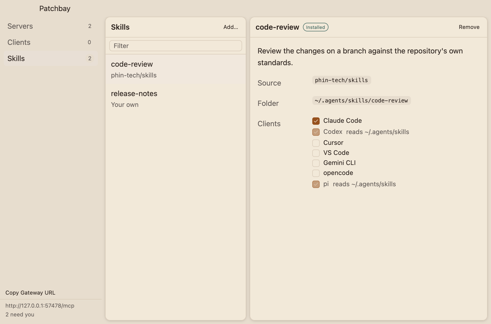

# Your skills

A skill is a folder with a `SKILL.md` in it: instructions, and sometimes scripts, that an AI tool reads when the work
calls for it. Patchbay installs skills the way `npx skills add -g` ([skills.sh](https://skills.sh)) does, in the same
folders and with the same record of where each came from. So Patchbay and the `skills` CLI look after one set of
skills: what either installs, the other lists, checks and updates.



## Adding skills

Choose **Add Skills…** in the Skills menu, or **Add…** above the list, and give it a source. Anything `npx skills add`
takes works here:

| Source | |
| --- | --- |
| `vercel-labs/agent-skills` | a GitHub repository |
| `vercel-labs/agent-skills@web-design-guidelines` | one skill in it |
| `https://github.com/owner/repo/tree/main/skills/review` | one folder, at a branch |
| `https://git.phin.tech/team/skills.git`, `git@github.com:owner/repo.git` | any other git repository |
| `~/src/my-skills` | a folder on your Mac |

A whole line copied from skills.sh or a README works too, flags and all:
`npx skills add vercel-labs/agent-skills --skill web-design-guidelines -a claude-code`.

Press Return and Patchbay fetches the source and lists the skills in it. It looks where the `skills` CLI looks:
a `SKILL.md` at the top, `skills/`, the tools' own skills folders, and the paths a `skills.sh.json` or a Claude
plugin names. Tick the ones you want and choose **Install**.

## Where skills go

Each skill is kept once, in `~/.agents/skills/<name>`, and linked into the folder of each tool that has one of its
own. Tools that read `~/.agents/skills` themselves need no link.

| Tool | Its skills folder |
| --- | --- |
| Claude Code | `~/.claude/skills` |
| Cursor | `~/.cursor/skills` |
| VS Code (Copilot) | `~/.copilot/skills` |
| Gemini CLI | `~/.gemini/skills` |
| opencode | `~/.config/opencode/skills` |
| Codex, pi | read `~/.agents/skills` itself |

A new skill goes to every tool Patchbay finds on your Mac, or only the ones a pasted line names with `-a`. Tick or
untick a tool on the skill's page to give it the skill or take it away.

Where each skill came from is kept in `~/.agents/.skill-lock.json`, the `skills` CLI's own record, which Patchbay adds
to and never empties. Like the CLI, `patchbay skills` finds it in `$XDG_STATE_HOME/skills` when that's set, and
opencode's folder in `$XDG_CONFIG_HOME`. The app, opened from the Finder, never sees those, so if you set them, set
them for apps too (`launchctl setenv`) or the app and your terminal will each keep their own record.

## Skills of your own

A skill you put in a folder yourself shows as **Your own**, and Patchbay never replaces or removes it. **Take Over** on
its page (or **Take Over Every Skill** in the Skills menu) puts it in Patchbay's care:

- It's kept in `~/.agents/skills`, if it isn't there already.
- Each tool's copy becomes a link to that one, but only where the files are the same. A copy you've changed, or a link
  of your own to somewhere else, is left as it is.
- It's listed as from **This Mac**, so there's nothing to fetch updates from.

Then you can choose which tools have it, or remove it.

## Updates

**Check for Skill Updates** fetches each skill's source and marks the ones that have changed, with the files that
differ. **Update** on a skill's page applies its update; **Update All Skills** applies every one. A skill is
instructions an agent follows and code it may run, so look at what changed before you take it.

## From a terminal

```sh
patchbay skills add vercel-labs/agent-skills --skill web-design-guidelines -a claude-code
patchbay skills add owner/repo --list    # what's in it, without installing
patchbay skills list                     # every skill, where it's from, and which tools have it
patchbay skills check                    # which have changed at their source
patchbay skills update                   # apply those changes
patchbay skills remove web-design-guidelines
```

`add` takes the flags `npx skills add` takes: `--skill` (or `-s`, `'*'` for every one), `--agent` (or `-a`, `'*'`
for every tool), `--list`, and `-g` and `-y`, which change nothing since Patchbay always installs for every project.
