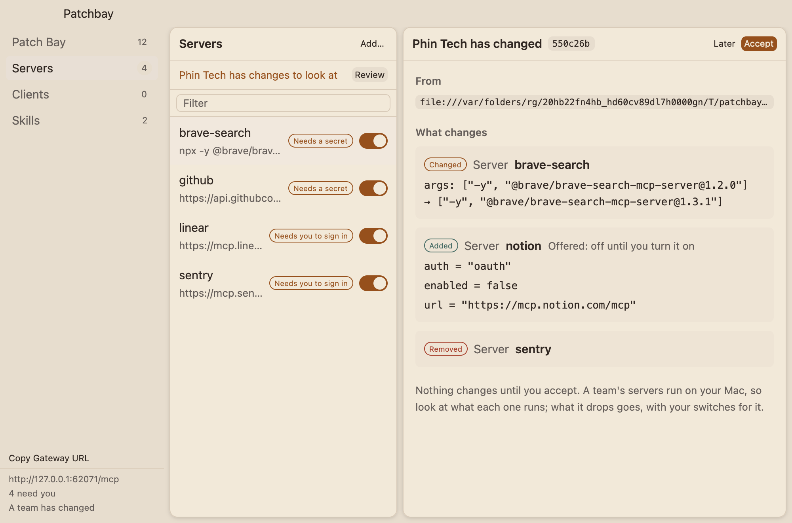

# Your team's servers and skills

A team keeps its servers and skills in a git repository, in a `patchbay.toml` at its top. Each person subscribes to
it, and Patchbay checks it for changes. Its servers run on your Mac with your own keys, and anything you add stays
yours.



## The team's repository

```toml
# patchbay.toml, at the top of git.example.com/acme/patchbay-team
[team]
name = "Acme"

# Secrets are only named. Each person gives their own, and Patchbay keeps it in their Keychain.
[secrets.github-token]
prompt = "A GitHub token with repo and read:org"
help = "https://github.com/settings/personal-access-tokens/new"

[servers.github]
command = "npx"
args = ["-y", "@modelcontextprotocol/server-github@2025.4.8"]   # pin versions
env = { GITHUB_PERSONAL_ACCESS_TOKEN = "secret:github-token" }

# Offered but off: listed for everyone, and on only for those who turn it on.
[servers.notion]
url = "https://mcp.notion.com/mcp"
auth = "oauth"
enabled = false

[skills]
sources = [".", "vercel-labs/agent-skills"]   # "." is this repository, with skills in skills/<name>/SKILL.md
install = ["code-review", "web-design-guidelines"]
```

The team decides what's on and what's only offered:

- A server is on for everyone unless the team writes `enabled = false`, which offers it instead. Anyone can switch
  either kind on or off for themselves. The switch is saved in their own `patchbay.toml`, never the team's.
- The skills named in `install` are installed when you subscribe, or when an update adds them. Any other skill in
  the team's `sources` is only offered. Add it from **Skills ▸ Add Skills…** with that source.

To publish a change, push to the repository.

## Subscribing

Choose **Subscribe to a Team…** in the Servers menu and give the repository: a git URL
(`git@git.example.com:acme/patchbay-team.git`, `https://…`) or `owner/repo` on GitHub. A branch and a name of your
own for the team are optional. Press Return, and Patchbay fetches it and lists everything it adds: each server and
what it runs, each secret it asks for, and its skills. Nothing is kept until you choose **Subscribe**.

The team's secrets are yours. Patchbay asks for each one when its server first starts, and keeps it under the team's
name in your Keychain (`acme/github-token`). Your keys never go to the team's repository, and the team never sees
them.

A private repository on GitHub works once you've signed in with the GitHub CLI (`gh auth login`): Patchbay asks
`gh` for your sign-in whenever git needs one. Patchbay's git never shows a prompt. Anywhere else, use an SSH URL with a
key your ssh-agent holds, or clone the repository once in a terminal so git's credential helper saves your sign-in.
The same goes for skills from a private repository.

## Changes

Patchbay checks each team when it opens and every hour after that, unless you turn that off in **Settings ▸ Subscriptions**,
which lists the teams you're subscribed to. **Check Teams for Changes** checks at once. A team
with changes is listed above your servers. **Review** shows what changed: servers added, removed or changed, field by
field, with the old and new value of each. Nothing changes until you choose **Accept**, which takes in exactly the
commit you looked at. **Later** leaves it for now.

When a team drops a server, your switch for it goes too. A skill the team drops stays installed: remove it yourself
if you don't want it. A skill of your own with the same name as one of the team's is never replaced. Updates to the
team's skills come through **Check for Skill Updates**, like any other skill.

Removing a team (**Remove Team** on one of its servers) takes out its servers and its subscription. Its keys stay in
your Keychain, so subscribing again doesn't ask for them.

## A LiteLLM proxy

If your organisation keeps its MCP servers in a [LiteLLM](https://docs.litellm.ai/docs/mcp) proxy, subscribe to that
instead: **Subscribe to LiteLLM…** in the Servers menu. Give the proxy's URL (its `/ui` admin page's works too) and
your LiteLLM key, the `sk-…` it gave you. Patchbay asks LiteLLM for the MCP servers your key can use and lists them
before anything is kept, as it does a team's.

Each server is reached through LiteLLM, at its own path, with your key:

```toml
[servers.github_mcp]
url = "https://litellm.example.com/GitHub_MCP/mcp"
headers = { x-litellm-api-key = "Bearer ${secret:litellm-key}" }
tool_prefix = "GitHub_MCP-"
```

So the servers run where LiteLLM runs, never on your Mac, and LiteLLM keeps their own keys and decides what your key
may use. LiteLLM puts each server's name before its tools' (`GitHub_MCP-search_issues`); Patchbay takes it off, so
your AI tools see `github_mcp__search_issues`. Your LiteLLM key is kept in your Keychain, under the team's name
(`litellm/litellm-key`).

To replace your key, paste the new one under the LiteLLM in **Settings ▸ Subscriptions**, which lists it beside your
teams, and choose **Replace Key**. Every one of its servers uses that key, so they all start again with it.

Checking teams asks LiteLLM again. A server added, taken out or renamed there waits above your servers to be
reviewed like any team's change, and nothing changes until you accept. Change the servers in LiteLLM, not in
Patchbay's copy, which it writes again. A server waiting for an admin's approval in LiteLLM isn't listed until it's
approved.

```sh
patchbay teams litellm https://litellm.example.com            # asks for your key, shows the servers
patchbay teams litellm https://litellm.example.com --accept <version>   # keeps them
```

`PATCHBAY_LITELLM_KEY` gives the key without asking for it. `patchbay teams check` and `patchbay teams update`
work for it as for any team, with the version shown in place of a commit.

## From a terminal

```sh
patchbay teams add git@git.example.com:acme/patchbay-team.git   # shows what it adds
patchbay teams add git@git.example.com:acme/patchbay-team.git --accept <commit>   # keeps it
patchbay teams                                                  # every team, and the commit accepted
patchbay teams check                                            # which teams have changed
patchbay teams update acme                                      # shows what changed
patchbay teams update acme --accept <commit>                    # takes in that commit and its skills
```

Each command that shows changes ends with the command that accepts them, with the full commit. Commits from the
same branch made after that one wait for the next check.

`patchbay.lock`, in `~/Library/Application Support/tech.phin.patchbay`, records each team's repository and the commit
last accepted.
